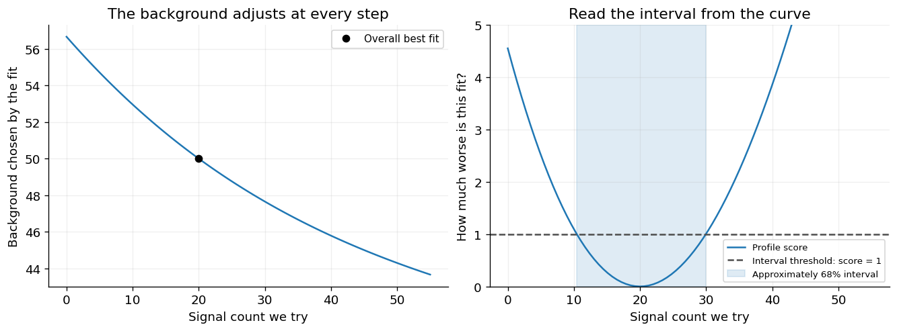
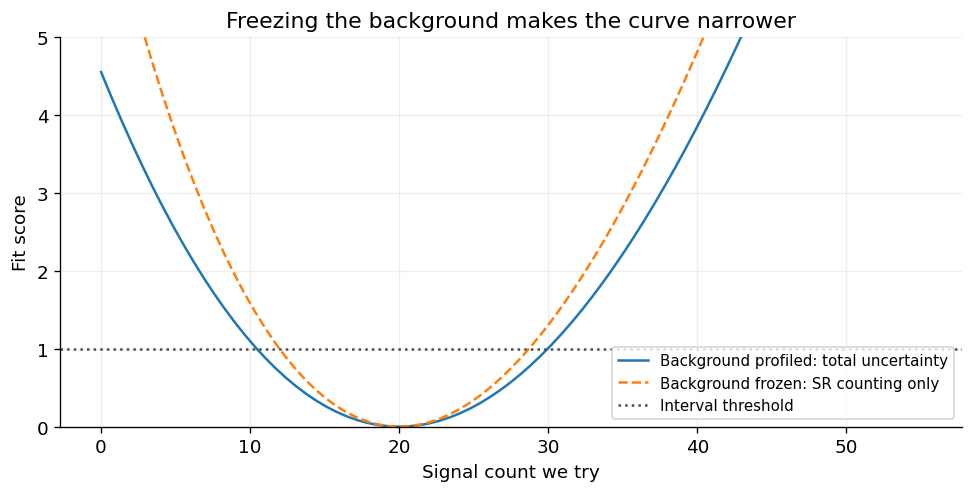
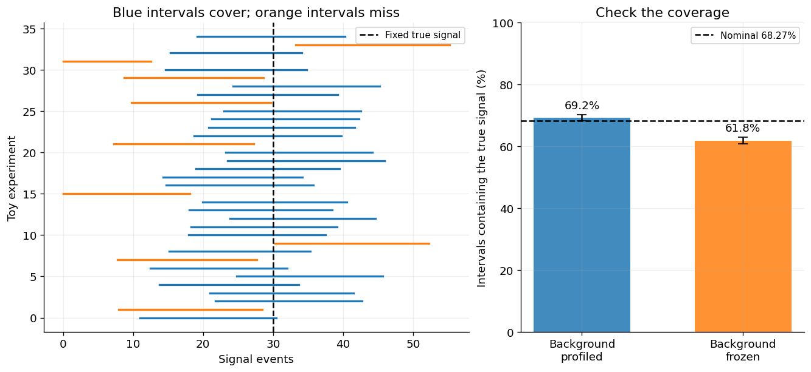

<div align="center">

# 📈 PL_01: Profile Likelihood Fits: ¿cuánta señal hay y qué tan seguros estamos?

### Un experimento de conteo como en física de partículas: **señal + fondo, banda lateral, verosimilitud perfilada, MINOS y cobertura con *toy experiments***

[](https://colab.research.google.com/github/DanielV-13/ADFM---PL_01_profile_likelihood_RESUELTO_Daniel_Vaca.ipynb/blob/main/ADFM_PL_01_profile_likelihood_RESUELTO_Daniel_Vaca.ipynb)


-0033A0)


**Análisis de Datos en Física Moderna (ADFM)**, Universidad de Oviedo · 2026

</div>

---

## 📑 Tabla de contenidos

1. [Sobre el proyecto](#-sobre-el-proyecto)
2. [El experimento](#-el-experimento)
3. [El camino del cuaderno](#%EF%B8%8F-el-camino-del-cuaderno)
4. [La idea clave: perfilar el fondo](#-la-idea-clave-perfilar-el-fondo)
5. [Resultados](#-resultados)
6. [Respuestas a los ejercicios](#-respuestas-a-los-ejercicios)
7. [Lo que aprendí](#-lo-que-aprendí)
8. [Cómo ejecutarlo](#%EF%B8%8F-cómo-ejecutarlo)
9. [Créditos](#-créditos)

---

## 📌 Sobre el proyecto

Este repositorio contiene mi versión **resuelta y comentada en español** de la práctica *PL_01: Profile Likelihood Fits*, creada por el profesor **Pietro Vischia** para la asignatura ADFM.

La práctica responde a cuatro preguntas fundamentales del análisis de datos en física de partículas:

1. ❓ ¿Cómo estimamos una **señal** cuando parte de los eventos contados son **fondo**?
2. ❓ ¿Cómo incluimos la **incertidumbre del fondo**?
3. ❓ Si repetimos el experimento, ¿con qué frecuencia nuestro intervalo **contiene la señal verdadera**?
4. ❓ ¿Cuánta de la incertidumbre final **viene del fondo**?

### ✍️ ¿Qué añadí sobre el cuaderno original?

| Añadido | Descripción |
| :--- | :--- |
| ✅ **Respuestas a los 3 ejercicios** | Marcadas como **RESPUESTA**, junto con las preguntas guía y la tabla de resultados para entregar. |
| 📐 **Derivaciones matemáticas** | De las dos Poisson a la **NLL**, paso a paso, incluyendo por qué se eliminan los términos constantes. |
| 📊 **Notas teóricas** | El 68.27 % y la escala de sigmas (y por qué se exigen **5σ** para un descubrimiento), Poisson y $\sqrt{N}$, probabilidad vs. verosimilitud, el **teorema de Wilks** y la $\chi^2_1$. |
| ⚙️ **Notas sobre iminuit** | MIGRAD, Simplex como red de seguridad, MINOS, los límites físicos y los parámetros congelados. |
| 💬 **Código comentado** | Comentarios en español en las funciones `nll`, `fit_counts` y en las simulaciones. |
| 🧪 **Prueba extra con 2000 *toys*** | Repetí el estudio de cobertura con el doble de simulaciones para ganar precisión. |

---

## 🔬 El experimento

Buscamos una partícula nueva en un pequeño intervalo de masa (**región de señal**) y medimos el fondo en una región vecina sin señal (**banda lateral**), que es el doble de ancha ($\tau = 2$).

| Región | Observado | Esperado en promedio |
| :--- | :---: | :---: |
| 🎯 **Región de señal** | $n = 70$ | $s + b$ |
| 📏 **Banda lateral** (*sideband*) | $m = 100$ | $\tau b = 2b$ |

- $s$ → **parámetro de interés** (lo que queremos medir).
- $b$ → **parámetro de molestia** (*nuisance*): no es el objetivo, pero el modelo lo necesita.

### La verosimilitud

$$L(s,b) = \text{Poisson}(n \mid s+b) \times \text{Poisson}(m \mid \tau b)$$

$$\text{NLL}(s,b) = (s+b) - n\ln(s+b) + \tau b - m\ln(\tau b)$$

El segundo término es el **término de restricción** (*constraint term*): la banda lateral "tira" de $b$ hacia 50, pero le deja moverse.

---

## 🗺️ El camino del cuaderno

| # | Etapa | ¿Qué pregunta responde? |
| :---: | :--- | :--- |
| 1 | 🔬 El experimento y la estimación a mano | ¿Qué esperamos antes de ajustar? (Ejercicio 1) |
| 2 | 📐 La verosimilitud y la NLL | ¿Cómo comparamos explicaciones posibles $(s, b)$? |
| — | ⚙️ Ajuste con `iminuit` (MIGRAD) | ¿Cuál es el mejor $(s, b)$? |
| 3 | 🔄 Perfilar el fondo y el *score* | Para cada $s$, ¿cuál es el mejor $b$? (Ejercicio 2) |
| — | 📏 Intervalo del 68 % con MINOS | ¿Dónde cruza el *score* el valor 1? |
| 4 | 🧊 Fondo perfilado vs. congelado | ¿Cuánto error aporta la banda lateral? |
| 5 | 🎲 *Toy experiments* y cobertura | ¿El intervalo del "68 %" acierta de verdad el 68 % de las veces? (Ejercicio 3) |
| 6 | 🎯 Ideas clave y entrega | ¿Qué me llevo? |
| + | 🧪 Pruebas extra | 2000 *toys* (y un intento con 1 000 000) |

---

## 🔄 La idea clave: perfilar el fondo

Para saber qué otros valores de señal son compatibles con los datos:

1. **Fijamos** una señal hipotética $s$.
2. **Reajustamos** el fondo $b$ para que la explique lo mejor posible, teniendo en cuenta la banda lateral.
3. **Medimos** cuánto empeora el ajuste:

$$\text{score}(s) = 2\,\big[\text{NLL}_{\text{mejor } b \text{ en } s} - \text{NLL}_{\text{mejor ajuste global}}\big]$$

Por el **teorema de Wilks**, el *score* sigue una $\chi^2_1$, así que **todos los $s$ con `score ≤ 1` forman el intervalo del ~68 % (±1σ)**.

<div align="center">

</div>

A la izquierda, el fondo se reajusta para cada señal probada (baja, pero **no** en la misma cantidad que sube la señal, porque la banda lateral lo frena). A la derecha, el intervalo se lee donde la curva cruza `score = 1`.

---

## 📊 Resultados

### 1. Ajuste y desglose de la incertidumbre

| Resultado | Valor |
| :--- | :---: |
| Señal ajustada $\hat{s}$ | **20.0 eventos** |
| Fondo ajustado $\hat{b}$ | 50.0 eventos |
| Intervalo ~68 % (**fondo perfilado**, MINOS) | **[10.4, 30.0]** (−9.6 / +10.0) |
| Intervalo ~68 % (fondo **congelado**) | [12.0, 28.7] |
| Error total | ≈ **9.8** eventos |
| Error por el conteo de la región de señal | ≈ 8.4 eventos ($\approx\sqrt{70}$) |
| Error por la banda lateral | ≈ 5.0 eventos ($\approx\sqrt{100}/2$) |

> 🧮 Los errores independientes se suman **en cuadratura**: $\sqrt{8.4^2 + 5.0^2} \approx 9.8$.

<div align="center">

</div>

Congelar el fondo produce una curva **más estrecha**: parece más preciso, pero ignora que el fondo también es incierto.

### 2. Cobertura con *toy experiments*

Simulamos el experimento muchas veces con una verdad fija ($s = 30$, $b = 50$) y contamos cuántos intervalos contienen la señal verdadera.

| *Toys* | Fondo **perfilado** | Fondo **congelado** | Objetivo |
| :---: | :---: | :---: | :---: |
| 1000 | **70.6 % ± 1.4** | 61.8 % ± 1.5 | 68.3 % |
| 2000 | **69.2 % ± 1.0** | 61.8 % ± 1.1 | 68.3 % |

<div align="center">

</div>

✅ El intervalo **perfilado** cubre lo que promete (~68 %).
❌ El intervalo **congelado** tiene **infracobertura** (*undercoverage*): falla más de lo que dice.

> ℹ️ Los "±" miden la precisión de la simulación (error de Monte Carlo), **no** la incertidumbre de la señal. Con más *toys* la estimación es más precisa, pero eso **no arregla** un método que infracubre. El intento con 1 000 000 de *toys* se detuvo manualmente por el tiempo de ejecución.

---

## ✅ Respuestas a los ejercicios

| Ejercicio | Respuesta |
| :--- | :--- |
| **1. Estimar antes de ajustar** | $2b = 100 \Rightarrow b = 50$, y $s = 70 - 50 = 20$. |
| **2. Predecir el movimiento** | Si $s$ sube, $b$ **baja**, porque $s + b \approx 70$. Pero no baja lo mismo (de 50 a 47.65 al pasar de $s = 20$ a $s = 30$), porque la banda lateral sigue tirando de $b$ hacia 50. |
| **3. Explicar el resultado** | El intervalo congelado es más estrecho porque trata $b$ como exactamente conocido e ignora la incertidumbre de la banda lateral (~5 eventos). Los *toys* lo demuestran: solo cubre el **61.8 %**, frente al **70.6 %** del perfilado. **No sirve como barra de error total.** |

---

## 📚 Lo que aprendí

- 📊 La **verosimilitud** no es una probabilidad sobre los parámetros: es una forma de **comparar explicaciones** de unos datos ya medidos.
- 📉 Se **minimiza la NLL** en lugar de maximizar $L$ por estabilidad numérica y porque los optimizadores (MIGRAD) están hechos para minimizar.
- 🧩 Una **medida auxiliar** (la banda lateral) introduce la incertidumbre del fondo mediante un **término de restricción**.
- 🔄 **Perfilar** significa reajustar los parámetros de molestia para cada valor del parámetro de interés.
- 📏 Gracias al **teorema de Wilks**, `score = 1` marca el intervalo del **68 % (±1σ)**, y `score = 4` el de **95 % (±2σ)**.
- 🧊 **Congelar** un parámetro de molestia da intervalos más bonitos pero **engañosos**.
- 🎲 La **cobertura** se comprueba con simulaciones: describe **el método** al repetir el experimento, no la señal.
- ⚛️ En física de partículas se exige **5σ** para declarar un descubrimiento.

---

## ▶️ Cómo ejecutarlo

### Opción 1: Google Colab (recomendada)
Haz clic en [](https://colab.research.google.com/github/DanielV-13/ADFM---PL_01_profile_likelihood_RESUELTO_Daniel_Vaca.ipynb/blob/main/ADFM_PL_01_profile_likelihood_RESUELTO_Daniel_Vaca.ipynb) y ejecuta las celdas en orden. La primera celda instala `iminuit`.

### Opción 2: Local
```bash
git clone https://github.com/DanielV-13/ADFM---PL_01_profile_likelihood_RESUELTO_Daniel_Vaca.ipynb.git
cd ADFM---PL_01_profile_likelihood_RESUELTO_Daniel_Vaca.ipynb
pip install iminuit numpy scipy matplotlib pandas jupyter
jupyter notebook ADFM_PL_01_profile_likelihood_RESUELTO_Daniel_Vaca.ipynb
```

> ⚠️ La sección de **1 000 000 de *toys*** tarda muchísimo. No hace falta ejecutarla: es solo un experimento para ver qué pasaba.

---

## 📁 Estructura del repositorio

```
ADFM---PL_01_profile_likelihood_RESUELTO_Daniel_Vaca.ipynb/
├── ADFM_PL_01_profile_likelihood_RESUELTO_Daniel_Vaca.ipynb   # Cuaderno resuelto y comentado
├── img/                                                     # Gráficos extraídos del cuaderno
└── README.md                                                # Este archivo
```

---

## 🙏 Créditos

| | |
| :--- | :--- |
| 📘 **Cuaderno original** | *Profile Likelihood Fits* © **Pietro Vischia**, 2026 |
| ✍️ **Resolución y comentarios** | © **Daniel Vaca Velastegui**, 2026 |
| 🤖 **Asistencia** | **Gemini Flash** (Google) y **Claude Opus 5.5** (Anthropic) |
| 🛠️ **Herramienta** | [iminuit](https://scikit-hep.org/iminuit/), la interfaz de Python de **MINUIT** (CERN) |

---

<div align="center">

**Daniel Vaca Velastegui** · Estudiante de intercambio en la Universidad de Oviedo · ADFM 2026

*Más prácticas:* [PA_01: Autodiff](https://github.com/DanielV-13/ADFM---PA_01_autodiff) · [PA_02: Neural network from scratch](https://github.com/DanielV-13/ADFM---PA_02_neural_network_from_scratch)

</div>
